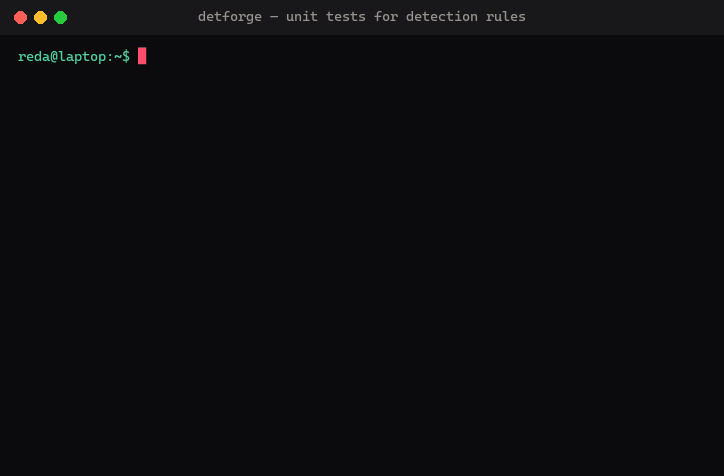

# DetForge

[](https://github.com/RedaKarrach/detforge/actions/workflows/ci.yml)

New here? Follow one rule from attack to merge, with a live rule lab: **https://redakarrach.github.io/detforge/**



Unit tests and CI for Sigma detection rules.

Most Sigma tooling converts rules (sigma-cli) or hunts through logs with them (Zircolite,
Chainsaw, Hayabusa). None of it tells you whether a rule still fires on the attack it was
written for, or whether a small edit made it match half of your benign traffic. DetForge
treats a rule like code: every rule ships with events it must match, events it must not
match, and a shared set of benign events that no rule may match. A push that breaks any
of that fails the build.

What you get on every push:

- `detforge lint`: the pySigma validators plus project conventions (naming, ATT&CK tags,
  required fields, fixtures present).
- `detforge test`: every rule run against its true-positive, true-negative and baseline
  events in SQLite. Fails with the exact event that was missed or wrongly matched.
- `detforge convert`: Splunk SPL and Elastic Lucene queries, written to `dist/`.
- `detforge coverage`: an ATT&CK Navigator layer and a tactic/technique summary.
- `detforge report`: a Markdown report that also lands in the GitHub Actions job summary.

The rules in `rules/` are Windows rules written and tested by the author. They are the
example content; the point of the repository is the harness around them. You can point it
at your own rules folder or fork the repository as a template.

## Quickstart

Python 3.11 or newer.

```
git clone https://github.com/RedaKarrach/detforge.git
cd detforge
python -m venv .venv
.venv\Scripts\activate          # Linux/macOS: source .venv/bin/activate
pip install -e ".[dev]"

detforge lint --offline
detforge test
detforge convert --target all
detforge coverage
detforge report
```

`detforge test` prints one line per rule:

```
| Rule                                                      |  TP | TN fp | Baseline fp | Result |
| rules/windows/execution/powershell_encoded_command.yml    | 3/3 |     0 |           0 | PASS   |
| rules/windows/lateral_movement/psexec_service_install.yml | 3/3 |     0 |           0 | PASS   |
```

`TP` is how many attack events matched out of the total. `TN fp` and `Baseline fp` are
benign events that matched; both must be zero. A failing rule is followed by the events
that caused it, using the `_description` you gave each event.

`detforge lint` without `--offline` also runs the two pySigma validators that download
MITRE data (`attacktag`, `d3_fendtag`). CI runs it online; use `--offline` on a machine
without network access.

## Layout

```
rules/windows/<tactic>/<rule_name>.yml   one rule per file, snake_case, tactic folder
tests/fixtures/<rule-id>/tp.jsonl        events the rule must match (at least 2)
tests/fixtures/<rule-id>/tn.jsonl        near-miss benign events it must not match (at least 2)
tests/fixtures/baseline/*.jsonl          shared benign events no rule may match
tests/data/                              deliberately broken rules used by the linter's tests
docs/RULES.md                            per rule: logic, false positives, evasions
dist/                                    generated output, git-ignored, uploaded by CI
```

## Writing a rule

1. Write the rule in `rules/windows/<tactic>/<rule_name>.yml`. The folder name must match
   one of the rule's tactic tags (`defense_evasion` for `attack.defense-evasion`). Required
   fields: `title`, `id` (UUID4), `status`, `description`, `author`, `date`, `logsource`,
   `detection`, `falsepositives`, `level`, `tags`, with at least one technique tag and one
   tactic tag. List a tactic tag before the techniques that belong to it; coverage uses that
   order.

2. Create `tests/fixtures/<rule id>/tp.jsonl` and `tn.jsonl`. One flat JSON object per line,
   using the field names the rule uses (Sysmon and Windows Security names: `Image`,
   `CommandLine`, `ParentImage`, `TargetObject`, `EventID`, `ServiceName`, ...). Keys that
   start with `_` are ignored by the matcher; use `_description` to say what the event is.

   ```
   {"_description": "short -e flag", "EventID": 1, "Image": "C:\\Windows\\System32\\WindowsPowerShell\\v1.0\\powershell.exe", "CommandLine": "powershell.exe -nop -w hidden -e SQBFAFgA..."}
   ```

   TN events should be near misses, not random noise: a `-Encoding UTF8` for a rule that
   looks for `-enc`, a service state change for a rule that looks for a service install.
   That is where rules actually break.

3. Add a row to `docs/RULES.md`: what the rule looks for, what legitimately trips it, and how
   an attacker gets around it. If you cannot write the last column, the rule is not finished.

4. Run `detforge lint --offline` and `detforge test`.

The best TP events come from running the technique in a lab VM with Sysmon installed and
exporting the real event. Synthetic events prove the logic; real events prove the field
names and values are what Windows actually writes.

## Baseline events

`tests/fixtures/baseline/` holds benign events that every rule is checked against. Each event
carries a `_logsource` key (`process_creation`, `system`, `security`, ...) and is only tested
against rules whose logsource category, or service when there is no category, has that name.
Add events here whenever a rule produces a false positive in your environment; the fix to the
rule then stays fixed.

## Using DetForge on your own rules

Every command accepts `--rules`, `--fixtures` and `--out`. Defaults can be set in your
`pyproject.toml`:

```toml
[tool.detforge]
rules = "sigma/rules"
fixtures = "sigma/tests"
out = "build"
author = "Your Name"   # optional: lint then requires this author on every rule
```

The layout checks assume `rules/windows/<tactic>/`. The harness, conversion and coverage do
not care where rules live.

## How the test harness works

Each rule is converted with pySigma's SQLite backend into a `SELECT * FROM logs WHERE ...`
query. All fixture events are loaded once into an in-memory table with one `TEXT COLLATE
NOCASE` column per field (Sigma matches case-insensitively, SQLite `=` does not) and a
`REGEXP` function registered for `|re` modifiers. Every rule's query runs against that table
and only the rule's own rows, plus the baseline rows of its logsource, are judged.

On 500 generated rules with a 2000-event baseline the full `detforge test` takes about 3
seconds; lint and convert are bounded by pySigma parsing and take 2 to 5 seconds.

## Limitations

- The fixtures in this repository are synthetic. They prove the rule logic, not that the
  field names and values match what a given Sysmon configuration writes.
- Only single-event rules are tested. Correlation rules and anything that needs more than
  one event are out of scope.
- SQLite tests the detection logic with the rule's own field names. It does not test the
  Splunk or Elastic field mappings produced by `detforge convert`; review those queries in
  the target SIEM.
- Lucene output uses pySigma's `ecs_windows` pipeline only. It maps field names but does
  not add an event code or channel filter for Sysmon categories.
- Keyword-only rules (a detection with no field names) are not supported by the SQLite
  backend and are reported as failures.

## Stack

pySigma 1.5 with the sqlite, splunk and elasticsearch backends and the sysmon and windows
pipelines; typer and rich for the CLI; pytest and ruff for the project's own tests.
GitHub Actions runs ruff, pytest and all five commands on every push and uploads `dist/`.

## License

MIT.
